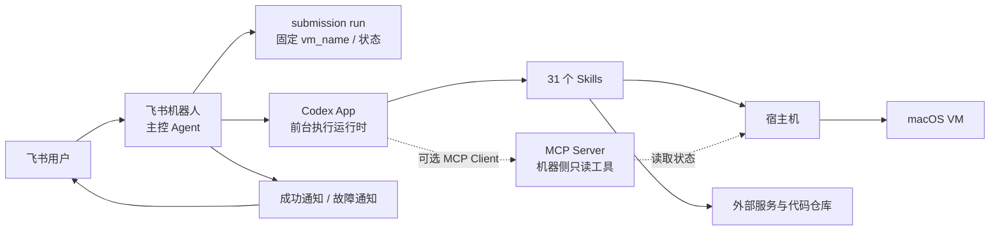
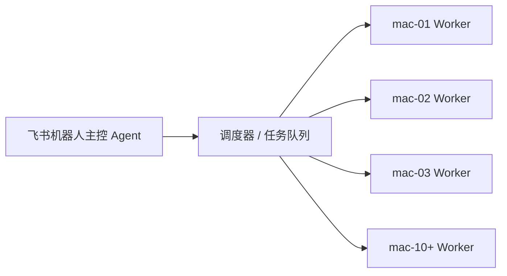

# mac 提审自动化

## 项目简介

这是一个通过飞书机器人发起、由 macOS 宿主机和 macOS VM 执行的 App 提审自动化项目。

本文档只介绍项目的整体流程、架构、Agent、Skills 和 MCP。Skills 的具体使用方法和执行细节不在这里展开，具体内容以对应的 `skills/<skill>/SKILL.md` 为准。

## 文档入口

- [项目架构说明](docs/project-architecture.md)
- [文档导航](docs/README.md)
- [项目总流程与交接手册](docs/project-workflow.md)
- [飞书机器人宿主机路由](docs/feishu-host-routing.md)
- [UTM 飞书机器人说明](docs/utm-feishu-bot.md)

## Agent、Skills、MCP 分别是什么

### Agent

Agent 是负责理解任务、组织流程和做决策的控制者。

当前项目只有 **1 个主控 Agent：飞书机器人**。

Codex App 前台会话是主控 Agent 使用的执行运行时，不单独计算为另一个 Agent。

### Skills

Skills 是主控 Agent 可以按流程调用的具体能力模块。本项目当前有 **31 个 Skills**，每个 Skill 对应一个 `skills/<skill>/SKILL.md` 文件。

### MCP

MCP 是一种让 Agent 以统一方式发现和调用外部工具的协议。

本项目已增加 **1 个机器侧 MCP Server**，位于 `integrations/mcp_worker_server.py`，默认通过 stdio 可选启动。当前主控 Agent 尚未作为 MCP Client 接入，因此 MCP Client 仍为 0 个。原有直接 API 和本机工具集成继续保留：Feishu/Notion API、SSH、UTM、本地脚本和浏览器 GUI/CDP。

**API 不等于 MCP**：API 是某个平台提供的接口；MCP 是 Agent 与工具之间的一层统一调用协议。只有把工具封装为 MCP Server，并由 MCP Client 按 MCP 协议发现和调用时，才计为 MCP。

## 当前架构数量

| 类型 | 数量 | 当前对象 |
|---|---:|---|
| 主控 Agent | 1 个 | 飞书机器人 |
| Skills | 31 个 | `skills/<skill>/SKILL.md` |
| 直接 API / 工具集成 | 多种 | Feishu/Notion API、SSH、UTM、本地脚本、GUI/CDP |
| MCP Server | 1 个 | `integrations/mcp_worker_server.py`，机器侧只读工具服务 |
| MCP Client | 0 个 | 主控 Agent 尚未接入 MCP Client |
| 执行环境 | 1 套 | 1 台宿主机 + 1 台 macOS VM |

## 当前架构图

## 当前提审流程图

## 当前使用的 31 个 Skills

这里只列名称，不展开每个 Skill 的使用方式和具体职责。

### 登记与准备

- `notion-utm`
- `notion-utm-1`
- `utm-clone-macos`

### VM 与宿主机

- `utm-1`
- `utm-2`
- `utm-3`
- `vm-down`
- `utm-4`
- `utm-5`
- `files`
- `utm-clash`
- `utm-6`

### Apple 账号、开发者和 App Store

- `utm-7`
- `utm-8`
- `utm-9`
- `utm-10`
- `utm-11`
- `utm-12`
- `utm-13`
- `utm-14`
- `utm-15`

### 应用资料、素材和构建

- `utm-16`
- `utm-17`
- `utm-18`
- `utm-19`
- `utm-20`
- `utm-21`
- `utm-22`

### 审核提交和通知

- `utm-23`
- `utm-24`
- `utm-25`

## MCP 已增加

仓库已经增加一个机器侧 MCP Server，先提供机器信息、Skill 清单和提审 run 状态三个只读工具。它不暴露密码、不执行任意 Shell，也不改变现有 31 个 Skills。

当前先以“可选工具边界”方式接入：主控 Agent 仍按原流程运行，后续再接入 MCP Client。

更适合继续增加 MCP 的场景是：多台机器、多个 Agent 或多个执行运行时需要用同一套机器工具，并且需要统一权限、审计和调用格式。调度器仍然负责排队和分配机器，MCP 不负责调度。

## 后续扩展方向

当前是一台宿主机配一台 macOS VM。扩展到 10 台以上机器时，架构可演进为：

主控 Agent 负责统一接收和编排任务，Worker 负责各自机器上的执行。未来每台 Worker 可以运行一个同类型 MCP Server，主控侧再增加 MCP Client。

## 相关说明

- [项目架构说明](docs/project-architecture.md)：本项目的简化架构总览。
- [MCP 集成说明](integrations/README.md)：机器侧 MCP Server、工具范围和启动方式。
- [项目总流程与交接手册](docs/project-workflow.md)：具体流程合同和交接规则。
- [技能目录](skills)：31 个 Skill 的实际定义。