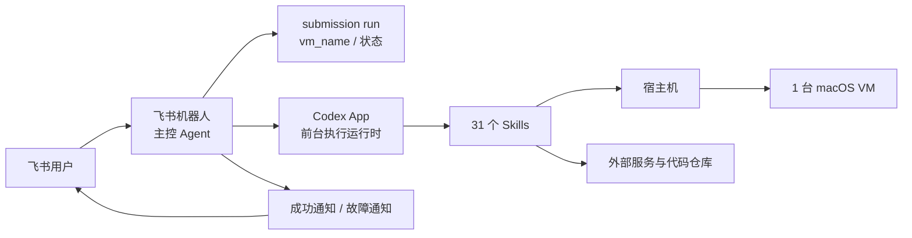
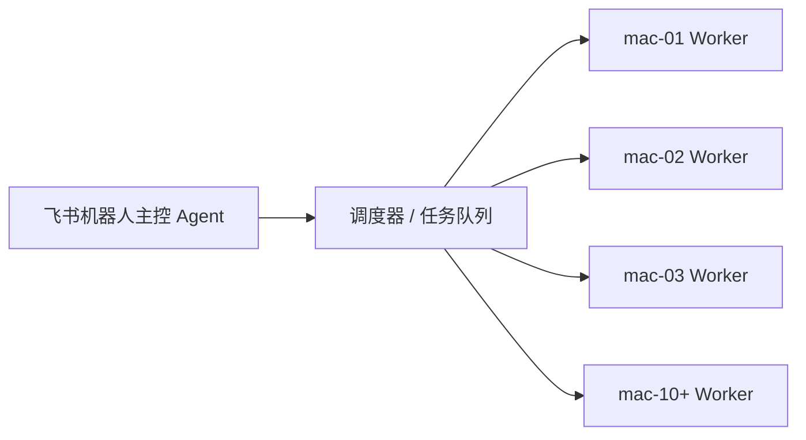

# mac 提审自动化：项目架构总览

> 整理日期：2026-09-17
> 本文只介绍流程、架构图、流程图，以及 Agent / Skills / MCP 的概念和数量。

## 1. 项目整体流程

简化理解：用户在飞书发起提审，飞书机器人创建一次 run，然后由执行运行时按固定顺序调用 31 个 Skills，在宿主机和 macOS VM 中完成提审流程，最后返回成功或故障通知。

## 2. Agent、Skills、MCP 是什么

### Agent

Agent 是负责理解目标、组织流程、做决策和汇总结果的控制者。

当前项目的主控 Agent 是 **飞书机器人，共 1 个**。

Codex App 前台会话是主控 Agent 的执行运行时，不作为第二个 Agent 统计。

### Skills

Skills 是 Agent 在流程中调用的能力模块。当前项目共有 **31 个 Skills**，对应仓库中的 `skills/<skill>/SKILL.md`。

本文只列出名称，不展开每个 Skill 的使用方法和具体职责。具体内容请查看对应 Skill 文件。

### MCP

MCP 是 Agent 统一发现和调用外部工具的一种协议。

当前项目共有 **0 个 MCP**，没有接入 MCP Client 或 MCP Server。当前使用的是直接 API 和本机工具集成：Feishu/Notion API、SSH、UTM、本地脚本和浏览器 GUI/CDP。

**API 不等于 MCP**：API 是平台直接提供的接口；MCP 是 Agent 与工具之间的统一调用协议。只有工具被封装成 MCP Server，并由 MCP Client 通过 MCP 协议发现和调用时，才属于 MCP。

## 3. 当前架构图

## 4. 当前数量

| 类型 | 数量 | 对象 |
|---|---:|---|
| 主控 Agent | 1 个 | 飞书机器人 |
| Skills | 31 个 | `skills/<skill>/SKILL.md` |
| 直接 API / 工具集成 | 多种 | Feishu/Notion API、SSH、UTM、本地脚本、GUI/CDP |
| MCP | 0 个 | 当前未接入 MCP Client/Server |
| 执行环境 | 1 套 | 1 台宿主机 + 1 台 macOS VM |

## 5. 当前 31 个 Skills

### 登记与准备

1. `notion-utm`
2. `notion-utm-1`
3. `utm-clone-macos`

### VM 与宿主机

4. `utm-1`
5. `utm-2`
6. `utm-3`
7. `vm-down`
8. `utm-4`
9. `utm-5`
10. `files`
11. `utm-clash`
12. `utm-6`

### Apple 账号、开发者和 App Store

13. `utm-7`
14. `utm-8`
15. `utm-9`
16. `utm-10`
17. `utm-11`
18. `utm-12`
19. `utm-13`
20. `utm-14`
21. `utm-15`

### 应用资料、素材和构建

22. `utm-16`
23. `utm-17`
24. `utm-18`
25. `utm-19`
26. `utm-20`
27. `utm-21`
28. `utm-22`

### 审核提交和通知

29. `utm-23`
30. `utm-24`
31. `utm-25`

## 6. MCP 是否可以增加

可以增加，但不建议为了增加数量而重写现有 API。

更适合增加 MCP 的场景是：未来有多台机器、多个 Agent 或多个执行运行时，需要统一调用机器工具，并且需要统一权限和审计。当前单机阶段直接使用 API、SSH 和 UTM 更简单。

建议保留现有 API 和 Skills，在机器侧逐步增加受限的 MCP Server，封装机器健康检查、VM 状态、Skill 执行和结果读取等能力。调度器仍然负责任务排队和机器分配，MCP 不负责调度。

## 7. 后续多机架构

当前为一台宿主机和一台 macOS VM。未来管理 10 台以上机器时，建议从单机执行扩展为“主控 Agent + 调度器 + 多个 Worker”：

Agent 统一负责任务编排和结果汇总；每个 Worker 对应一台机器。MCP 只有在后续需要统一封装机器工具调用时再引入，不作为任务调度器。

## 8. 相关文件

- Skills 实际定义：`skills/<skill>/SKILL.md`
- 具体流程和交接：[`docs/project-workflow.md`](project-workflow.md)
- 飞书入口说明：[`docs/utm-feishu-bot.md`](utm-feishu-bot.md)
- 多宿主机路由：[`docs/feishu-host-routing.md`](feishu-host-routing.md)