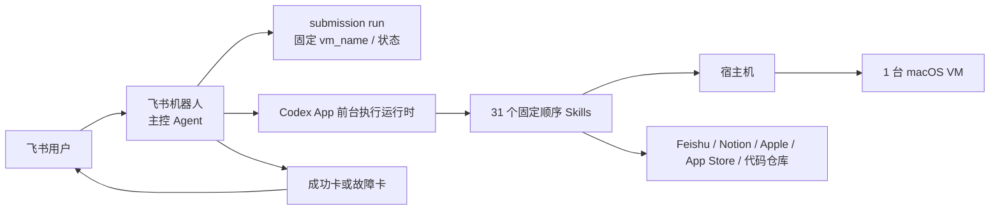

# mac 提审自动化：Agent / Skills / MCP 架构

> 整理日期：2026-09-17
> 依据：当前仓库实现，以及《飞书机器人项目-架构拆解（概念设计）》中的概念分层。
> 说明：本文只区分 Agent、Skills、MCP，并说明当前架构和后续扩展方式；概念设计中的内容不等同于当前已经实现的功能。

## 1. 先说结论

| 类型 | 数量 | 当前项目中的对象 |
|---|---:|---|
| 主控 Agent | **1 个** | **飞书机器人** |
| Skills | **31 个** | `skills/<skill>/SKILL.md` |
| MCP | **0 个** | 当前没有 MCP Client 或 MCP Server |
| 执行环境 | 1 套 | 1 台宿主机 + 1 台 macOS VM |

最重要的一点：**飞书机器人就是主控 Agent**。Codex App 前台会话只是主控 Agent 使用的执行运行时，不单独算一个 Agent。

## 2. Agent、Skills、MCP 分别是什么

### 2.1 Agent：1 个

当前只有一个主控 Agent：**飞书机器人**。

它负责：

- 接收飞书提审登记和用户指令；
- 校验目标宿主机；
- 创建一次提审 `run`，生成并固定 `vm_name`；
- 按固定顺序调用 31 个 Skills；
- 处理暂停、继续、失败恢复和停止；
- 发送成功卡或故障卡。

执行时，飞书机器人会把本次 run 交给 Codex App 前台会话执行。Codex App 是运行时，不是第二个 Agent。

### 2.2 Skills：31 个

Skills 是主控 Agent 调用的具体执行步骤，不负责全局决策。

#### 登记与准备（3 个）

1. `notion-utm`
2. `notion-utm-1`
3. `utm-clone-macos`

#### VM 与宿主机基础环境（9 个）

4. `utm-1`
5. `utm-2`
6. `utm-3`
7. `vm-down`
8. `utm-4`
9. `utm-5`
10. `files`
11. `utm-clash`
12. `utm-6`

#### Apple 账号、开发者和 App Store（9 个）

13. `utm-7`
14. `utm-8`
15. `utm-9`
16. `utm-10`
17. `utm-11`
18. `utm-12`
19. `utm-13`
20. `utm-14`
21. `utm-15`

#### 应用资料、素材和构建（7 个）

22. `utm-16`
23. `utm-17`
24. `utm-18`
25. `utm-19`
26. `utm-20`
27. `utm-21`
28. `utm-22`

#### 审核提交和通知（3 个）

29. `utm-23`
30. `utm-24`
31. `utm-25`

执行关系很简单：

```text
飞书机器人主控 Agent
        ↓ 固定顺序调用
31 个 Skills
        ↓ 在本机执行
宿主机 + macOS VM
```

### 2.3 MCP：0 个

当前仓库没有：

- MCP Client；
- MCP Server；
- MCP 工具注册和 `tools/call` 调用；
- 用 MCP 做机器发现或任务调度的代码。

当前使用的集成方式是 Feishu/Notion API、SSH、UTM、本地脚本、浏览器 GUI/CDP。这些都不能因为“可以被调用”就直接称为 MCP。

## 3. 当前架构



当前项目的边界：

- 一次 run 只绑定一台宿主机和一台 macOS VM；
- 31 个 Skill 按固定顺序执行，不能跳步；
- `vm_name` 在创建 run 时生成，后续 Skill 只使用它；
- 当前没有统一的多机任务队列、机器注册中心或 Worker 集群；
- 当前也没有 MCP 层。

## 4. 后续怎么优化

建议按下面顺序演进，不要一开始把所有东西都改成多 Agent 或 MCP：

### 第一步：先把单机执行标准化

增加三个简单对象：

```text
机器注册表：记录机器是否在线、能力和当前任务
任务记录：记录 run、当前 Skill、状态和重试次数
执行结果：统一返回成功/失败、错误摘要和成功证据
```

先把当前单机流程的状态记录清楚，再扩容。

### 第二步：增加调度器和 Worker

把“主控 Agent 决策”和“机器上执行”拆开：

```text
飞书机器人主控 Agent
        ↓
调度器 / 任务队列
        ↓
mac-01 Worker、mac-02 Worker、mac-03 Worker……
        ↓
每台机器自己的 macOS VM 和本地 Skills
```

主控 Agent 只负责目标、分配、流程和结果汇总；Worker 只负责本机动作，不自行改变全局流程。

### 第三步：有实际需要时再引入 MCP

如果未来需要让不同机器以统一接口暴露能力，可以再增加 MCP：

```text
主控 Agent（MCP Client）
    ├─ mac-01 MCP Server
    ├─ mac-02 MCP Server
    └─ mac-03 MCP Server
```

MCP 只解决“如何标准化调用工具”，不解决“任务分给哪台机器”和“如何排队”。调度仍由调度器/任务队列负责。

## 5. 一个 Agent 如何管理 10 台以上机器

不建议让飞书主控 Agent 直接同时操作 10 台机器的 GUI。正确做法是：

```text
一个主控 Agent
    → 一个调度器 / 任务队列
        → 10+ 个机器 Worker
            → 每个 Worker 管自己的宿主机和 macOS VM
```

### 主控 Agent 管什么

- 接收提审任务；
- 根据机器能力和空闲状态选择机器；
- 为任务分配 `machine_id`；
- 只跟踪摘要状态：排队、执行中、成功、失败；
- 失败时决定重试、换机、暂停或通知用户；
- 汇总 10+ 台机器的结果。

### Worker 管什么

- 心跳和健康检查；
- 在本机启动/检查 VM；
- 执行指定 Skill；
- 读取 GUI、SSH、UTM 和脚本结果；
- 返回结构化结果和成功证据；
- 不直接修改其他机器，也不改变 31 步主流程。

### 10+ 台机器必须有的控制机制

1. **机器注册表**：`machine_id`、能力、状态、最后心跳时间。
2. **任务队列**：任务等待空闲机器，不让 Agent 自己维护并发列表。
3. **租约/锁**：一个 run 同时只能被一台机器执行。
4. **每台机器并发数为 1**：先保证 VM 和 Apple 账号现场不互相污染。
5. **超时和重试**：超时释放租约；有限次数重试，避免死循环。
6. **故障隔离**：心跳丢失、SSH 不通或连续失败的机器进入隔离状态。
7. **摘要回传**：Agent 只接收状态、错误摘要和证据，不接收所有 GUI 细节。

推荐的最小多机架构：

```text
飞书机器人主控 Agent
        ↓
API / 调度器 / 任务队列
        ↓
机器注册表 + 运行记录
        ↓
10+ 台 Worker
        ├─ 本机 macOS
        ├─ 本机 UTM VM
        ├─ 本机 Skills
        └─ 本机敏感凭证
```

## 6. 最终判断

```text
现在：飞书机器人 1 个主控 Agent + 31 个 Skills + 0 个 MCP

后续：飞书机器人主控 Agent
      + 调度器/任务队列
      + 10+ 个机器 Worker
      + 必要时再增加 MCP Server
```

其中：

- Agent 负责决策和编排；
- Skills 负责具体步骤；
- Worker 负责某一台机器的执行；
- 调度器负责排队、分配、租约和重试；
- MCP 只在确有统一工具调用需求时引入。
